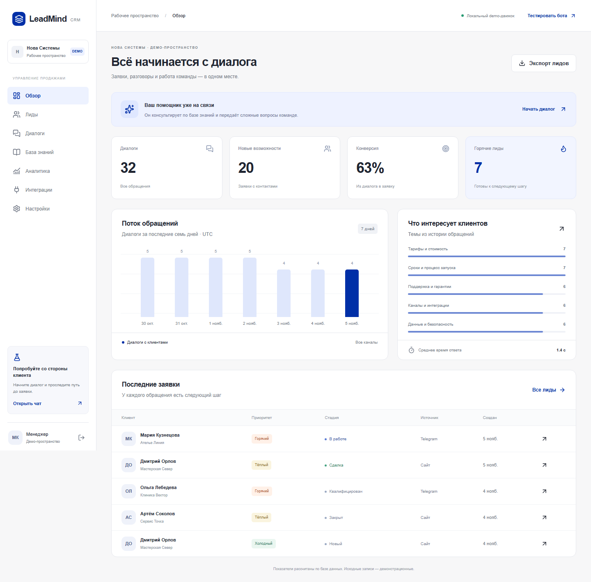
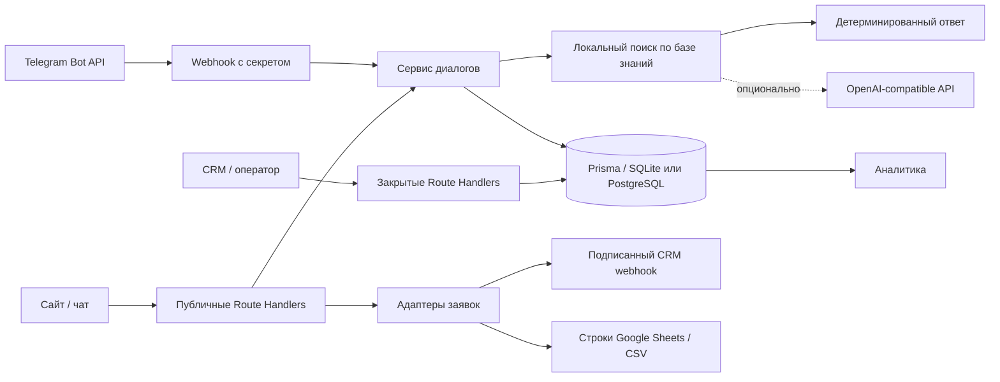
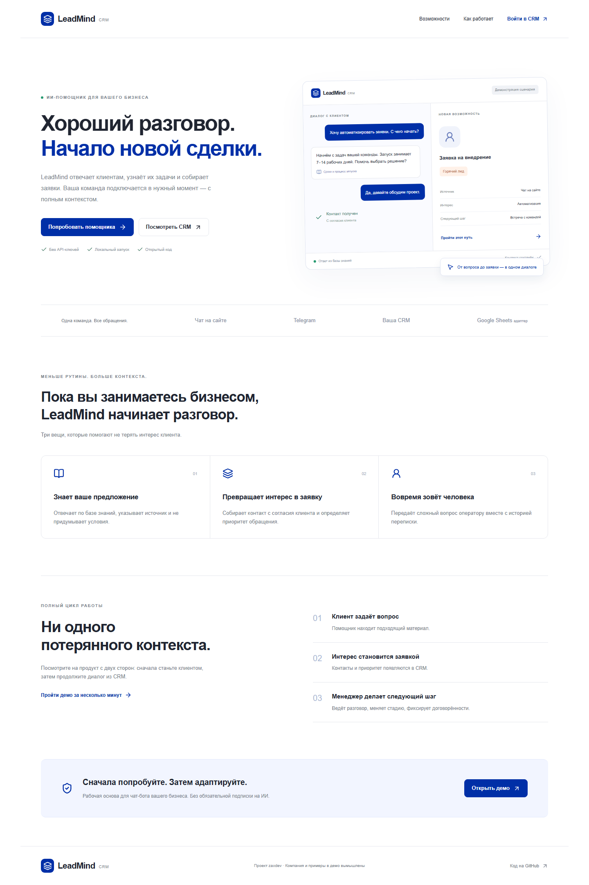
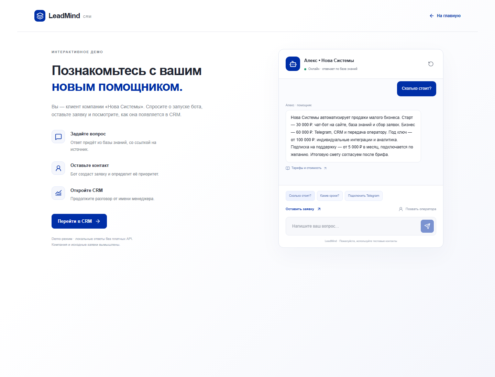
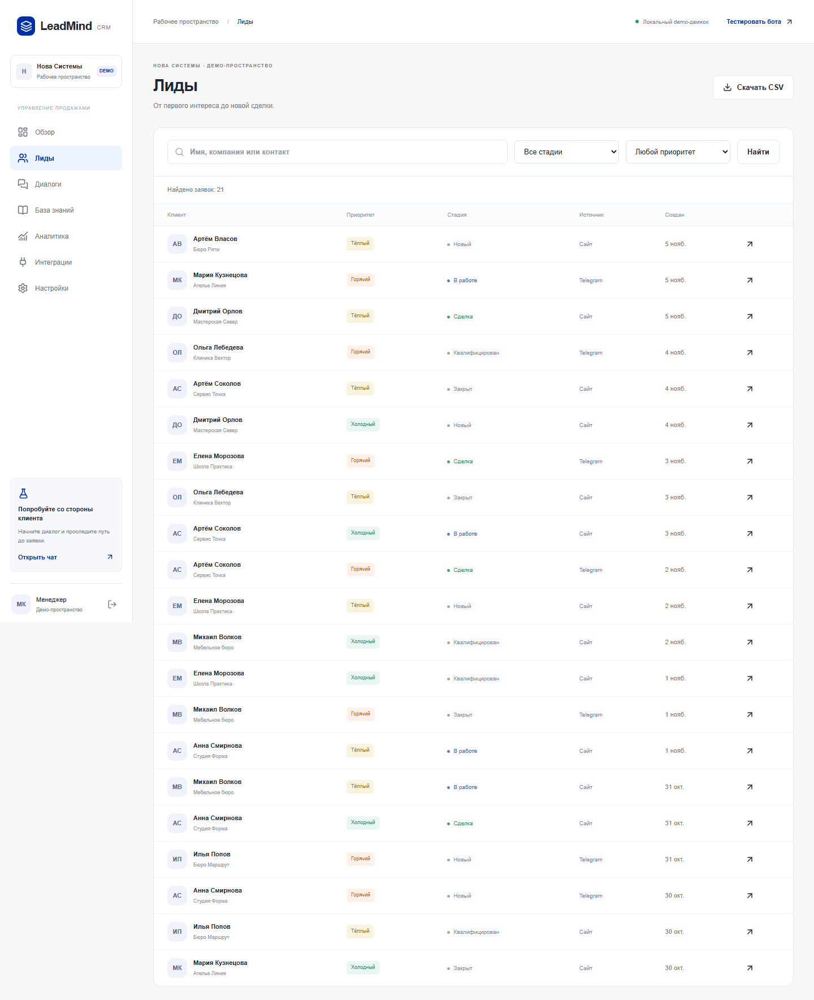
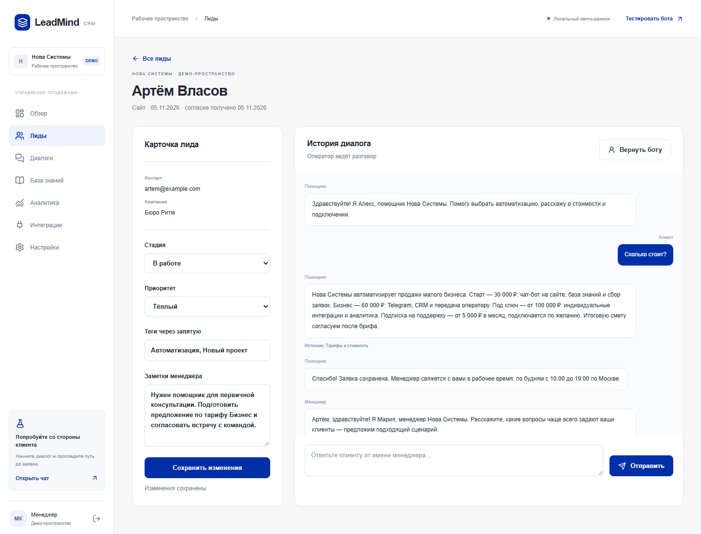
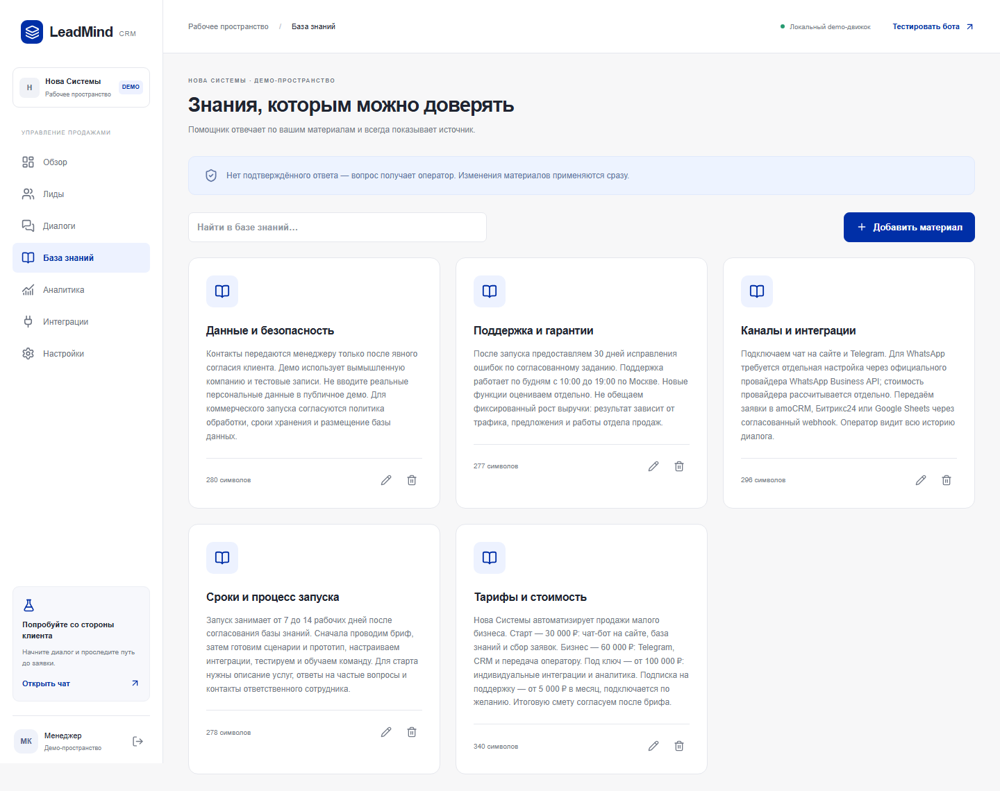
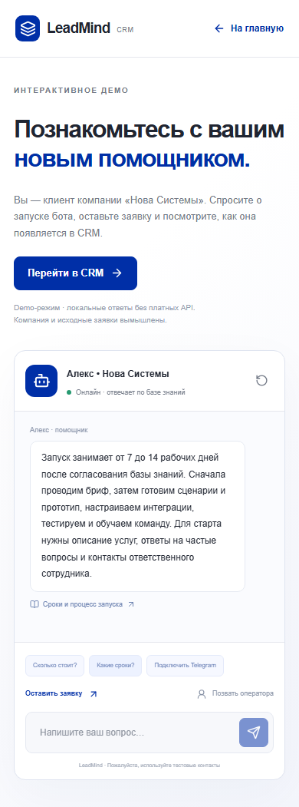

# LeadMind CRM

**Каждый диалог ближе к сделке.** Помощник для бизнеса, который консультирует по базе знаний, собирает заявки и передаёт разговор менеджеру вместе с контекстом.

AI-powered business chatbot with CRM, lead qualification, knowledge base and human handoff.



Учебно-коммерческий демонстрационный продукт [zaxdev](https://github.com/zaxdevv). «Нова Системы», имена и исходные заявки вымышлены. Репозиторий можно использовать как основу заказного решения; показатели демо не являются результатами реального бизнеса.

## Задача бизнеса

Посетитель задаёт вопрос вечером, менеджер видит его утром без контекста, контакт теряется. LeadMind начинает консультацию сразу, фиксирует интерес и передаёт человеку переписку. Менеджер работает с заявкой в том же пространстве: меняет стадию, добавляет заметки и отвечает клиенту.

## Возможности

- Чат с быстрыми вопросами, историей в БД, индикатором ответа, источниками и формой контактов с явным согласием.
- Локальный поиск по материалам. Вопрос вне базы, попытка подмены инструкций или просьба о менеджере приводит к передаче оператору.
- CRM: контакты, источник, переписка, пять стадий, три приоритета, поиск, фильтры, теги и заметки.
- Ответ оператора доходит до браузера клиента через опрос раз в пять секунд. В Telegram — через Bot API.
- Аналитика из БД: диалоги, заявки, конверсия, горячие лиды, среднее время ответа, темы и семь дней обращений.
- CRUD базы знаний, изменение имени помощника и приветствия.
- Telegram webhook, CSV с защитой от формул, подписанный исходящий webhook и подготовка строк Google Sheets.
- Работа без ИИ-ключа и Telegram-токена, адаптивный интерфейс, Docker Compose, CI.

## Быстрый запуск

Нужен Node.js 22.12+ (рекомендуется 22 LTS), npm и Git. PostgreSQL для локального демо не требуется.

```sh
git clone https://github.com/zaxdevv/leadmind-crm.git
cd leadmind-crm
npm ci
cp .env.example .env
```

На Windows вместо `cp` используйте `Copy-Item .env.example .env`. Если PowerShell запрещает `npm.ps1`, выполняйте `npm.cmd` и `npx.cmd`.

Сгенерируйте секрет, вставьте результат в `AUTH_SECRET` в `.env`:

```sh
node -e "console.log(require('node:crypto').randomBytes(32).toString('hex'))"
npm run setup
npm run dev
```

Откройте [localhost:3000](http://localhost:3000). `setup` генерирует Prisma Client, применяет миграции и добавляет 32 диалога, 20 заявок и пять материалов. Повторный seed не стирает существующие данные. `.env.example` включает `DEMO_LOGIN_ENABLED=true`: вход в CRM одной кнопкой, все посетители демо видят общую базу. Используйте только тестовые контакты.

Production локально:

```sh
npm run build
npm start
```

На Windows остановите работающий сервер перед повторной генерацией Prisma Client: загруженная DLL может быть заблокирована процессом Node.

## Сценарий показа заказчику

1. Откройте `/demo`, нажмите «Сколько стоит?». Ответ содержит условия из источника «Тарифы и стоимость».
2. Напишите «Хочу заказать бота». Оставьте вымышленное имя и `client@example.com`, отметьте согласие.
3. В другой вкладке откройте `/dashboard`, нажмите «Войти в демо».
4. Найдите заявку в `/dashboard/leads`, откройте её. Приоритет будет горячим. Измените стадию, теги и заметку.
5. Примите диалог и отправьте сообщение менеджера. Оно появится в клиентском чате в течение пяти секунд.
6. Откройте аналитику, скачайте CSV. Показатели изменяются вместе с базой.

## Архитектура



Один Next.js-процесс, без отдельных воркеров и vector database. `KnowledgeRetriever` — граница для будущего embeddings/pgvector, `LeadSink` — контракт записи во внешние системы. Приоритет — прозрачные правила по словам намерения; это не обученная модель скоринга. Внешний ИИ работает в режиме извлечения предложений: сервер проверяет, что каждое предложение существует в документе, иначе возвращает исходный материал. Запрос клиента не включается в инструкцию провайдеру.

Стек: Next.js 16 App Router, React 19, строгий TypeScript, Tailwind CSS 4 и CSS-токены, Lucide, Prisma 6, SQLite/PostgreSQL, Zod, Vitest, Playwright. Версии зафиксированы lockfile. Overrides закрывают advisories транзитивных `deepmerge-ts` и `minimatch`; совместимость проверяется build/lint/tests.

## Переменные окружения

| Переменная                | Назначение                                                   |
| ------------------------- | ------------------------------------------------------------ |
| `DATABASE_URL`            | `file:./dev.db` для SQLite; PostgreSQL URL в Vercel          |
| `AUTH_SECRET`             | Случайный секрет от 32 символов, обязателен в production     |
| `DEMO_LOGIN_ENABLED`      | `true` разрешает публичный demo-вход; `false` требует пароль |
| `ADMIN_PASSWORD`          | Пароль менеджера при отключённом demo-входе                  |
| `APP_URL`                 | Публичный origin, например `https://your-app.vercel.app`     |
| `OPENAI_API_KEY`          | Ключ внешнего ИИ; без ключа работает локальная база          |
| `OPENAI_BASE_URL`         | OpenAI-compatible URL с `/v1`, без завершающего `/`          |
| `OPENAI_MODEL`            | Идентификатор модели провайдера                              |
| `TELEGRAM_BOT_TOKEN`      | Токен BotFather                                              |
| `TELEGRAM_WEBHOOK_SECRET` | Секрет входящего Telegram webhook                            |
| `CRM_WEBHOOK_URL`         | HTTPS-адрес приёмника новых заявок                           |
| `CRM_WEBHOOK_SECRET`      | Общий секрет HMAC-SHA256                                     |

Переменные хранятся только на сервере. Измените `.env` и перезапустите приложение. Панель интеграций показывает наличие настройки, но не проверяет доступность провайдера.

## Docker

```sh
cp .env.example .env
# Установите собственный AUTH_SECRET в .env
docker compose up --build -d
docker compose logs -f app
```

Приложение доступно на порту 3000. База находится в volume `leadmind-data`; миграции и безопасный seed выполняются при запуске. `docker compose down` сохраняет volume. Сборка использует Node 22.23.4 Debian и OpenSSL. Сборка и запуск выполняются от непривилегированного пользователя `node` (UID 1000); `/app` и `/data` принадлежат ему. GitHub Actions дополнительно проверяет запуск контейнера с новым volume и доступность demo-страницы. Docker Engine должен быть запущен.

## Telegram

Создайте бота в BotFather. Задайте токен, длинный случайный `TELEGRAM_WEBHOOK_SECRET` и публичный HTTPS `APP_URL`. Зарегистрируйте webhook (пример для bash; секреты берутся из окружения, не вставляйте их в репозиторий):

```sh
curl -X POST "https://api.telegram.org/bot${TELEGRAM_BOT_TOKEN}/setWebhook" \
  --data-urlencode "url=${APP_URL}/api/telegram" \
  --data-urlencode "secret_token=${TELEGRAM_WEBHOOK_SECRET}" \
  --data-urlencode 'allowed_updates=["message"]'
```

Принимаются приватные текстовые сообщения до 2 000 символов. `/start` объясняет возможности. Диалоги видны в CRM, включая обращения без заявки; оператор может принять диалог и ответить в Telegram. Собрать контакт с согласием можно через предложенную ссылку на форму сайта. Эта форма создаёт отдельную веб-сессию: объединение контактов между каналами оставлено для коммерческой адаптации. Обработанные `update_id` не принимаются повторно; при сбое между записью сообщения и подтверждением возможна повторная доставка. Для production нужен transactional inbox/outbox.

## Внешний ИИ

Установите `OPENAI_API_KEY`, `OPENAI_BASE_URL`, `OPENAI_MODEL`. Движок сначала находит локальный документ, затем просит модель выбрать дословные предложения. Ответ без проверяемого источника не публикуется. Таймаут — 12 секунд, при сбое возвращается исходный текст. Без ключа сценарий полностью работоспособен. Вызовы внешнего провайдера могут тарифицироваться им: проект не подключает платные услуги автоматически.

## Webhook во внешнюю CRM

После создания заявки отправляется `POST` на серверный `CRM_WEBHOOK_URL`. Пример тела:

```json
{
  "event": "lead.created",
  "id": "lead-id",
  "createdAt": "2026-11-05T09:00:00.000Z",
  "name": "Тестовый клиент",
  "contact": "client@example.com",
  "priority": "hot",
  "company": "Пример"
}
```

`X-LeadMind-Signature` — hex HMAC-SHA256 **сырых байтов тела** с `CRM_WEBHOOK_SECRET`. На стороне приёмника сравнивайте подпись в постоянное время и дедуплицируйте по `Idempotency-Key` (ID лида). Таймаут пять секунд, редиректы запрещены. Результат записывается в журнал интеграций; сбой внешней CRM не отменяет локальную заявку. Автоматические повторы пока не реализованы. URL задаёт владелец сервера, публичный пользователь изменить его не может.

Google Sheets: `sheetsRow` формирует строки, журнал отмечает их подготовку, `/api/admin/export?sheets=1` скачивает CSV для импорта. Прямой записи в Google нет; реализуйте `LeadSink` с OAuth или service account для конкретной таблицы. Текущий адаптер намеренно не заявляет об отправке данных.

## Тестирование

```sh
npm ci
npm run setup
npm run lint
npm run typecheck
npm test
npm run build
npx playwright install chromium
npm start
# В другом терминале:
npm run test:e2e
npm run format:check
npm audit
```

E2E использует работающий сервер на `http://localhost:3000`; другой адрес задаётся через `TEST_BASE_URL`. Тесты создают тестовые заявки: запускайте их на отдельной demo-базе, не на рабочих данных. Покрыты консультация с источником, согласие, создание лида, сохранение стадии, handoff, ответ оператора, CSV, ограничения API, CRUD знаний и мобильное переполнение. Модульные тесты проверяют поиск, защиту от подмены инструкций, приоритет и CSV injection. GitHub Actions выполняет эти проверки на Node 22. Результаты фактической локальной проверки: [docs/verification.md](docs/verification.md).

## Развёртывание на Vercel

SQLite-файл не подходит для постоянного хранения в Vercel Functions. Для Vercel подготовлена отдельная схема `prisma/postgres.prisma`, совпадающая по моделям с локальной.

1. Импортируйте репозиторий в Vercel на бесплатном Hobby, если условия тарифа подходят вашему использованию. Не подключайте платные дополнения.
2. Подключите существующий PostgreSQL или создайте базу на бесплатном плане провайдера. Установите её URL в `DATABASE_URL` и локально для первоначальной инициализации.
3. Выполните `npm run db:postgres` и `npm run db:seed` с PostgreSQL URL. `db:postgres` генерирует клиент под PostgreSQL. SQLite-миграции не применяются к PostgreSQL.
4. Задайте `AUTH_SECRET`, `APP_URL`, `DEMO_LOGIN_ENABLED=true` для публичного тестового демо. Для закрытой CRM — `false` и `ADMIN_PASSWORD`.
5. `vercel.json` выбирает `npm run build:vercel`. После deploy проверьте `/demo` и создание заявки. Для локального возврата к SQLite выполните `npm run setup` с исходным URL.

Для коммерческого использования проверьте условия хостинга, разместите БД в согласованной юрисдикции и замените demo-доступ полноценной авторизацией. Подготовлена конфигурация, но публичный deploy не выполнялся без авторизованной платформы и PostgreSQL.

## Структура

```text
src/app/          страницы и HTTP-границы
src/components/   интерфейс чата, CRM, редакторов
src/services/     диалоги, поиск, аналитика, интеграции
src/lib/          БД, валидация HTTP, сессии, правила домена
prisma/           две схемы БД, миграции SQLite, безопасный seed
tests/            unit и браузерные проверки
docs/portfolio/   скриншоты, кейс, Kwork, предложение, Mermaid
scripts/          воспроизводимое создание скриншотов
```

## Безопасность и границы демо

HttpOnly/SameSite cookie с HMAC и TTL восемь часов, Secure на HTTPS; проверка origin; rate limiting; Zod на входе; лимит тела и длины сообщений; параметризованные Prisma-запросы; React-экранирование без HTML из сообщений; Telegram secret; CSV formula escaping. Публичный чат читается по секретному токену браузера. Материалы базы знаний доступны публично по ссылкам источников: не размещайте в них внутренние сведения.

Demo-вход открыт всем при `DEMO_LOGIN_ENABLED=true`. Это общая песочница, без RBAC, MFA, восстановления пароля и изоляции организаций. Rate limiter хранится в памяти одного процесса и рассчитан на доверенные заголовки reverse proxy; при масштабировании нужен Redis и лимиты на edge. Поиск по основам слов требует редакторской настройки ключевых слов. Нет автоматической очереди повторов webhook, прямого WhatsApp и Google OAuth, вложений и real-time SSE. Приветствие и тексты — русские, другие языки потребуют материалов и сценариев. Публичная форма предупреждает не вводить реальные персональные данные.

Дальше: pgvector, мультитенантность и роли, transactional outbox, SSE, WhatsApp Business API, Google OAuth, бизнес-календарь, аудит изменений, удаление данных по сроку хранения.

## Интерфейс








## Лицензия

[MIT](LICENSE).
